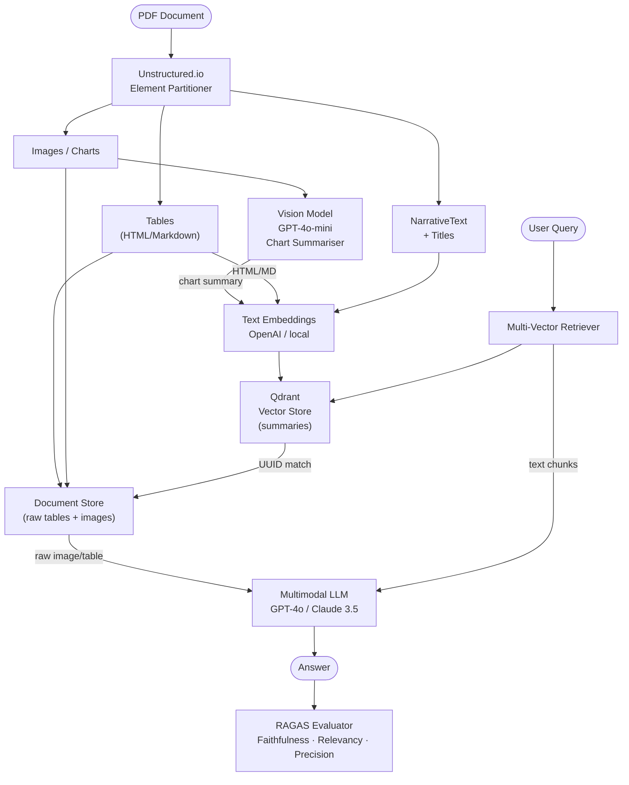

# Multimodal RAG Pipeline

> **Layout-aware document ingestion, multi-vector retrieval, vision-model reasoning, and RAGAS evaluation** — built for complex PDFs with tables, charts, and mixed content.

[](https://www.python.org/)
[](https://www.langchain.com/)
[](https://qdrant.tech/)
[](https://openai.com/)
[](https://docs.ragas.io/)
[](LICENSE)

---

## What It Does

Most RAG systems treat a PDF as a flat stream of text. This pipeline treats it as a **structured document** — preserving the distinction between prose, tables, and charts, and handling each differently.

It is **not a basic PDF loader + vector search**. It integrates:
- Layout-aware element extraction (Unstructured.io) with separate handling for `Title`, `NarrativeText`, `Table`, and `Image`
- Vision-model summarisation of charts and figures (GPT-4o-mini) to make visual content searchable
- A **multi-vector retrieval strategy**: summaries are embedded and searched; raw tables/images are retrieved for the final answer
- Multimodal generation: the LLM receives both text excerpts and the actual cropped chart image
- **RAGAS evaluation**: Faithfulness, Answer Relevancy, and Context Precision scored and benchmarked against a baseline

---

## Architecture



### Pipeline Flow

1. **Ingestion** — Unstructured.io partitions the PDF into typed elements. Tables are converted to HTML/Markdown. Charts are passed through GPT-4o-mini to generate a textual summary.
2. **Indexing** — Text chunks, table representations, and chart summaries are embedded and stored in Qdrant. Raw tables and images are stored in a document store, linked by UUID.
3. **Retrieval** — A multi-vector retriever searches the summary embeddings. On a match, the corresponding raw image or table is fetched from the document store.
4. **Generation** — The LLM receives text excerpts plus the actual chart image, enabling genuine multimodal reasoning.
5. **Evaluation** — RAGAS computes Faithfulness, Answer Relevancy, and Context Precision. A benchmark script compares this pipeline against a text-only RAG baseline.

---

## Key Features

| Feature | Detail |
|---|---|
| 📄 Layout-aware ingestion | Title, NarrativeText, Table, Image element types |
| 🖼 Vision-model chart summarisation | GPT-4o-mini generates searchable text from figures |
| 🗂 Multi-vector retrieval | Summary embeddings → UUID → raw data fetch |
| 🧠 Multimodal generation | LLM sees both text context and the actual chart image |
| 📊 RAGAS evaluation | Faithfulness, Answer Relevancy, Context Precision |
| 📈 Baseline benchmark | Multimodal vs text-only RAG comparison script |
| 🗃 Qdrant vector store | Persistent, filterable, production-ready |

---

## Tech Stack

| Layer | Technology |
|---|---|
| Document parsing | Unstructured.io |
| Embeddings | OpenAI `text-embedding-3-small` (swappable) |
| Vector store | Qdrant |
| Document store | Local filesystem / S3-compatible |
| Vision model | GPT-4o-mini |
| Generation | GPT-4o / Claude 3.5 Sonnet |
| Orchestration | LangChain |
| Evaluation | RAGAS |
| Environment | Python 3.10+, python-dotenv |

---

## Repository Structure

```
multimodal-rag-pipeline/
├── main.py                        # CLI entrypoint — ingest, query, evaluate
├── requirements.txt               # Python dependencies
├── .env.example                   # Environment variable reference
├── Dockerfile                     # Container build
│
├── ingestion/
│   ├── partitioner.py             # Unstructured.io PDF element extraction
│   ├── table_converter.py         # Table → HTML/Markdown conversion
│   └── image_summariser.py        # Vision model chart summarisation
│
├── retrieval/
│   ├── embedder.py                # Embedding model wrapper
│   ├── vector_store.py            # Qdrant index management
│   ├── document_store.py          # Raw table/image storage (UUID-linked)
│   └── multi_vector_retriever.py  # Summary search → raw data fetch
│
├── generation/
│   └── rag_chain.py               # Multimodal prompt construction + LLM call
│
├── evaluation/
│   ├── ragas_evaluator.py         # RAGAS metric computation
│   └── benchmark.py              # Multimodal vs baseline comparison
│
├── docs/
│   ├── architecture.md            # System design notes
│   └── evaluation-results.md      # Benchmark results (fill in after running)
│
└── tests/
    ├── test_partitioner.py
    ├── test_retriever.py
    └── test_ragas.py
```

---

## Quick Start

### Prerequisites

- Python 3.10+
- An OpenAI API key (GPT-4o + embeddings)
- A running Qdrant instance ([Docker one-liner](https://qdrant.tech/documentation/quick-start/) or Qdrant Cloud free tier)

### 1 — Clone and install

```bash
git clone https://github.com/CarlAmine/multimodal-rag-pipeline.git
cd multimodal-rag-pipeline
python -m venv .venv && source .venv/bin/activate
pip install -r requirements.txt
```

### 2 — Configure environment

```bash
cp .env.example .env
# Fill in OPENAI_API_KEY and QDRANT_URL at minimum
```

### 3 — Start Qdrant (Docker)

```bash
docker run -p 6333:6333 qdrant/qdrant
```

### 4 — Ingest a document

```bash
python main.py ingest --pdf path/to/document.pdf
```

### 5 — Query

```bash
python main.py query --question "What does the Q3 revenue chart show?"
```

### 6 — Run evaluation

```bash
python main.py evaluate --dataset data/eval_dataset.json
```

---

## Configuration

| Variable | Required | Description |
|---|---|---|
| `OPENAI_API_KEY` | ✅ | Used for embeddings, vision model, and generation |
| `QDRANT_URL` | ✅ | Qdrant instance URL (e.g. `http://localhost:6333`) |
| `QDRANT_API_KEY` | Optional | Required for Qdrant Cloud |
| `COLLECTION_NAME` | Optional | Qdrant collection name (default: `rag_documents`) |
| `DOC_STORE_PATH` | Optional | Local path for raw image/table storage (default: `./doc_store`) |
| `LLM_MODEL` | Optional | Generation model (default: `gpt-4o`) |
| `EMBED_MODEL` | Optional | Embedding model (default: `text-embedding-3-small`) |

---

## Evaluation

This project uses [RAGAS](https://docs.ragas.io/) to score the pipeline on three metrics:

| Metric | What It Measures |
|---|---|
| **Faithfulness** | Does the answer stay grounded in the retrieved context? (hallucination prevention) |
| **Answer Relevancy** | Does the answer actually address the question? |
| **Context Precision** | Did the retriever surface the right chunks? |

### Benchmark: Multimodal vs Text-Only RAG

Run the comparison script to generate a score table:

```bash
python evaluation/benchmark.py --dataset data/eval_dataset.json
```

Results are written to `docs/evaluation-results.md`. See that file for scores after running on your documents.

> The benchmark is the key differentiator of this project. Documenting a measurable improvement on table-heavy questions is what makes this stand out in a portfolio or interview.

---

## Technical Highlights

- **Document Layout Analysis** — elements are typed (`Title`, `NarrativeText`, `Table`, `Image`) rather than treated as a flat text stream.
- **Vision-model summarisation** — charts are not skipped; they are described by a vision model and made fully searchable.
- **Parent-child retrieval** — summary embeddings are small and precise; raw data (full table HTML, high-res image) is fetched only at generation time.
- **Multimodal prompt construction** — the final LLM call includes both retrieved text and the actual image, enabling genuine chart reasoning.
- **Quantified evaluation** — RAGAS scores replace "it works" with measurable Faithfulness, Relevancy, and Precision values.
- **Baseline comparison** — a dedicated benchmark script isolates the contribution of the multimodal components.

---

## Limitations & Known Issues

- Unstructured.io's image extraction quality depends on PDF structure; scanned PDFs may require OCR pre-processing.
- Large PDFs (100+ pages) will incur meaningful OpenAI API costs during ingestion due to vision model calls per image.
- The document store is local-filesystem by default; production use should swap in S3 or similar.
- RAGAS evaluation requires a labelled eval dataset; building one is a manual step.

---

## Roadmap

- [ ] S3-backed document store
- [ ] Support for `unstructured` cloud API (higher quality parsing)
- [ ] Local embedding model option (reduce API cost)
- [ ] Streaming responses
- [ ] Gradio / Streamlit UI for interactive querying
- [ ] CI pipeline with automated RAGAS regression testing
- [ ] Support for DOCX and PowerPoint ingestion

---

## Contributing

See [CONTRIBUTING.md](CONTRIBUTING.md) for development setup and conventions.

---

## License

MIT — see [LICENSE](LICENSE).
