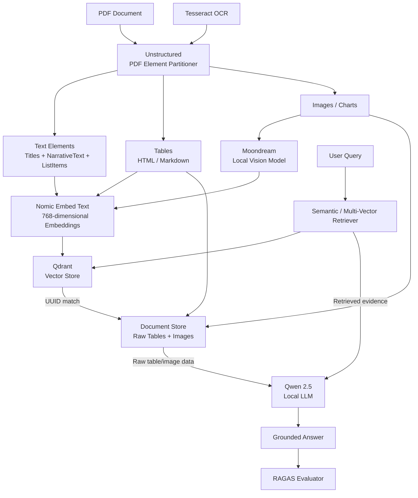

from pathlib import Path
import pypandoc

readme = r"""# Multimodal RAG Pipeline

> **Layout-aware document ingestion, multimodal processing, semantic retrieval, and grounded RAG generation** — designed for complex PDFs containing text, tables, images, and mixed content.


---

## What It Does

Most RAG systems treat a PDF as a flat stream of text. This pipeline treats a PDF as a **structured document**, preserving the distinction between prose, tables, and images and processing each type appropriately.

The project has been adapted to run **locally without requiring paid OpenAI APIs for the core embedding, vision, and generation workflow**.

It integrates:

- Layout-aware PDF element extraction using **Unstructured**
- Separate handling for `Title`, `NarrativeText`, `ListItem`, `Table`, and `Image`
- OCR support through **Tesseract**
- Local vision-model processing using **Moondream**
- Local text embeddings using **Nomic Embed Text**
- Semantic retrieval using **Qdrant**
- Raw table/image storage linked through UUID metadata
- Local answer generation using **Qwen 2.5**
- Generic, document-agnostic question answering
- RAGAS-based evaluation support

The pipeline is designed to work with different document types without hardcoding document-specific questions, entities, or answer rules.

---

## Architecture



---

## Pipeline Flow

### 1. Ingestion

A PDF is passed to Unstructured for layout-aware partitioning.

The pipeline identifies elements such as:

- Titles
- Narrative text
- List items
- Tables
- Images

For scanned or image-based PDF content, Tesseract OCR can provide text recognition.

### 2. Content Processing

Text is retained as searchable document content.

Tables are converted into searchable representations.

Images and charts are processed through the local **Moondream** vision model, which generates textual descriptions that can be embedded and retrieved.

### 3. Embedding

Document content is converted into vector representations using:

```text
nomic-embed-text
```

The configured embedding dimension is:

```text
768
```

### 4. Vector Storage

The embeddings are stored in **Qdrant**.

Indexed elements retain metadata such as:

- UUID
- Element type
- Document metadata
- Original content references

### 5. Retrieval

When a user asks a question:

1. The question is embedded using the same embedding model.
2. Qdrant performs semantic similarity search.
3. Relevant document elements are retrieved.
4. Duplicate and empty extraction artifacts are filtered.
5. Raw tables/images can be recovered through their UUIDs.

The retrieval layer is designed to remain **question-agnostic and document-agnostic**. It does not contain hardcoded logic for particular people, companies, documents, or question types.

### 6. Generation

Retrieved evidence is passed to **Qwen 2.5**, running locally through Ollama.

The generation layer is designed to:

- Answer the exact question
- Use only retrieved document evidence
- Avoid unsupported assumptions
- Produce concise answers
- Avoid exposing retrieval or evidence details

### 7. Evaluation

The project retains RAGAS evaluation support for measuring retrieval and generation quality.

---

## Key Features

| Feature | Detail |
|---|---|
| 📄 Layout-aware ingestion | Title, NarrativeText, ListItem, Table, Image element types |
| 🔎 Semantic retrieval | Question-to-document similarity search |
| 🧠 Local embeddings | Nomic Embed Text, 768 dimensions |
| 🖼 Local vision processing | Moondream generates searchable image descriptions |
| 🗂 Multi-vector retrieval | Embedded representations → UUID → raw data fetch |
| 🤖 Local generation | Qwen 2.5 through Ollama |
| 🔒 Local-first AI workflow | Core embedding, vision, and generation can run locally |
| 🗃 Qdrant vector store | Vector storage and similarity search |
| 📊 RAGAS evaluation | Faithfulness, Answer Relevancy, Context Precision |
| 📑 Document-agnostic | Designed for different PDF document types |

---

## Tech Stack

| Layer | Technology |
|---|---|
| Document parsing | Unstructured |
| OCR | Tesseract OCR |
| Embeddings | Ollama + `nomic-embed-text` |
| Vector store | Qdrant |
| Document store | Local filesystem |
| Vision model | Ollama + `moondream:1.8b` |
| Generation | Ollama + `qwen2.5:1.5b` |
| Orchestration | LangChain |
| Evaluation | RAGAS |
| Containerization | Docker |
| Environment configuration | Python + `python-dotenv` |

---

## Local AI Models

The current local configuration uses:

| Model | Purpose |
|---|---|
| `nomic-embed-text` | Document and query embeddings |
| `moondream:1.8b` | Image/chart understanding and summarisation |
| `qwen2.5:1.5b` | Final answer generation |

The models are served locally through **Ollama**.

The model names are configurable through environment variables, so the pipeline is not tied to these models.

---

## Repository Structure

```text
multimodal-rag/
│
├── main.py                         # CLI entrypoint — ingest, query, evaluate
├── requirements.txt                # Python dependencies
├── .env.example                    # Environment variable reference
├── Dockerfile                      # Container build
│
├── ingestion/
│   ├── partitioner.py              # Unstructured PDF element extraction
│   ├── table_converter.py          # Table → HTML/Markdown conversion
│   └── image_summariser.py         # Local vision model image summarisation
│
├── retrieval/
│   ├── embedder.py                 # Embedding model wrapper
│   ├── vector_store.py             # Qdrant index management
│   ├── document_store.py           # Raw table/image storage
│   └── multi_vector_retriever.py   # Semantic search + raw data retrieval
│
├── generation/
│   └── rag_chain.py                # Local LLM prompt + answer generation
│
├── evaluation/
│   ├── ragas_evaluator.py          # RAGAS metric computation
│   └── benchmark.py                # Benchmark comparison
│
├── docs/
│   ├── architecture.md             # System design notes
│   └── evaluation-results.md       # Evaluation results
│
└── tests/
    ├── test_partitioner.py
    ├── test_retriever.py
    └── test_ragas.py
```

---

## Quick Start

### Prerequisites

Install the following:

- Python 3.10+
- Docker Desktop
- Ollama
- Tesseract OCR
- Git

The core local pipeline does not require an OpenAI API key.

### 1 — Clone and install

```powershell
git clone <repository-url>
cd multimodal-rag

python -m venv .venv
.\.venv\Scripts\Activate.ps1

pip install -r requirements.txt
```

If `langchain-ollama` is not included in the installed requirements:

```powershell
python -m pip install -U langchain-ollama
```

### 2 — Install and verify Ollama

Install Ollama and make sure it is running.

Pull the configured local models:

```powershell
ollama pull nomic-embed-text
ollama pull moondream:1.8b
ollama pull qwen2.5:1.5b
```

Verify:

```powershell
ollama list
```

### 3 — Install and verify Tesseract

Install Tesseract OCR for your operating system.

On Windows, the installation directory is commonly:

```text
C:\Program Files\Tesseract-OCR
```

Verify:

```powershell
tesseract --version
```

If the command is not recognized, add the Tesseract installation directory to the system PATH.

### 4 — Start Qdrant

Run Qdrant using Docker:

```powershell
docker run -p 6333:6333 qdrant/qdrant
```

The local Qdrant endpoint is:

```text
http://localhost:6333
```

### 5 — Configure environment

Create a `.env` file in the project root:

```env
EMBED_MODEL=nomic-embed-text
EMBEDDING_DIMENSION=768
LLM_MODEL=qwen2.5:1.5b
VISION_MODEL=moondream:1.8b
QDRANT_URL=http://localhost:6333
COLLECTION_NAME=rag_documents
```

### 6 — Ingest a document

```powershell
python main.py ingest --pdf "path\to\document.pdf"
```

### 7 — Query the document

```powershell
python main.py query --question "What is this document about?"
```

Additional questions can be asked naturally based on the content of the ingested document.

### 8 — Run evaluation

```powershell
python main.py evaluate --dataset data/eval_dataset.json
```

---

## Configuration

| Variable | Required | Description |
|---|---|---|
| `EMBED_MODEL` | Optional | Ollama embedding model; default: `nomic-embed-text` |
| `EMBEDDING_DIMENSION` | Optional | Embedding vector size; default: `768` |
| `LLM_MODEL` | Optional | Ollama generation model; default: `qwen2.5:1.5b` |
| `VISION_MODEL` | Optional | Ollama vision model; default: `moondream:1.8b` |
| `QDRANT_URL` | Optional | Qdrant URL; default: `http://localhost:6333` |
| `QDRANT_API_KEY` | Optional | Qdrant API authentication |
| `COLLECTION_NAME` | Optional | Qdrant collection name; default: `rag_documents` |
| `DOC_STORE_PATH` | Optional | Raw table/image storage path |

---

## Running the System

### Ingest

```powershell
python main.py ingest --pdf "path\to\document.pdf"
```

The ingestion process:

```text
PDF
 ↓
Unstructured
 ↓
Text / Tables / Images
 ↓
OCR / Table conversion / Vision summarisation
 ↓
Nomic embeddings
 ↓
Qdrant
```

### Query

```powershell
python main.py query --question "Your question"
```

The query process:

```text
Question
 ↓
Nomic embedding
 ↓
Qdrant semantic search
 ↓
Relevant evidence
 ↓
Qwen 2.5
 ↓
Concise grounded answer
```

### Evaluate

```powershell
python main.py evaluate --dataset data/eval_dataset.json
```

---

## Multiple Documents

The Qdrant collection can contain embeddings from multiple ingested documents.

If multiple documents are indexed in the same collection, retrieval may return content from more than one document unless document-level metadata filtering is applied.

For a production multi-document knowledge base, document identifiers and metadata filters should be used to control the retrieval scope.

If the goal is to replace the current indexed document set, the Qdrant collection should be cleared or recreated before ingestion.

---

## Evaluation

This project uses [RAGAS](https://docs.ragas.io/) to evaluate the RAG pipeline.

| Metric | What It Measures |
|---|---|
| **Faithfulness** | Whether the answer remains grounded in retrieved context |
| **Answer Relevancy** | Whether the generated answer addresses the question |
| **Context Precision** | Whether relevant chunks are retrieved |

Run:

```powershell
python main.py evaluate --dataset data/eval_dataset.json
```

The evaluation requires a labelled evaluation dataset.

---

## Technical Highlights

### Document Layout Analysis

The PDF is partitioned into typed elements such as:

```text
Title
NarrativeText
ListItem
Table
Image
```

This preserves document structure instead of treating the entire PDF as one text stream.

### Local Multimodal Processing

Images can be processed through the local Moondream model and converted into textual descriptions that participate in retrieval.

### Local Embeddings

The embedding configuration uses:

```text
nomic-embed-text
        ↓
768-dimensional vector
        ↓
Qdrant
```

The Qdrant vector configuration is aligned with the selected embedding dimension.

### Generic Retrieval

The retriever is not hardcoded around a specific document, person, company, or question type.

The user's question determines relevant evidence through semantic similarity.

### Grounded Generation

The generation layer receives retrieved evidence and is instructed to:

- Answer the exact question
- Use only document-supported information
- Avoid unsupported assumptions
- Avoid mentioning evidence IDs
- Return concise answers

### Local-First Architecture

The core AI components can run locally:

```text
Ollama
 ├── Embedding Model
 ├── Vision Model
 └── Generation Model

Docker
 └── Qdrant
```

This reduces dependence on paid external AI APIs.

---

## Limitations & Known Issues

- PDF extraction quality depends on the structure and quality of the source document.
- Scanned PDFs may require Tesseract OCR.
- Large or complex PDFs can require significant local CPU and RAM resources.
- Small local language models may have limited reasoning capabilities.
- Image understanding quality depends on the selected vision model.
- Running multiple local AI components on resource-constrained hardware can be demanding.
- The current retrieval pipeline uses semantic similarity and lightweight filtering rather than a dedicated cross-encoder reranker.
- Multiple unrelated documents in the same Qdrant collection can cause cross-document retrieval unless document-level filtering is implemented.
- RAGAS evaluation requires a labelled evaluation dataset.

---

## Roadmap

- [ ] Document-level metadata filtering
- [ ] Hybrid keyword + semantic retrieval
- [ ] Cross-encoder reranking
- [ ] Conversation history and follow-up questions
- [ ] Streaming responses
- [ ] Gradio / Streamlit UI
- [ ] Automated RAGAS regression testing
- [ ] Support for DOCX and PowerPoint ingestion
- [ ] Improved local model support for low-memory systems
- [ ] Optional larger quantized models for improved answer quality

---

## Contributing

See [CONTRIBUTING.md](CONTRIBUTING.md) for development setup and conventions.

---

## License

MIT — see [LICENSE](LICENSE).
"""

output_path = "/mnt/data/README_generic.md"
pypandoc.convert_text(
    readme,
    "md",
    format="md",
    outputfile=output_path,
    extra_args=["--standalone"],
)

print(f"Created: {output_path}")
